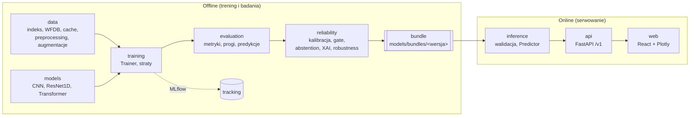

# CardioAI

System uczenia maszynowego do analizy 12-odprowadzeniowego EKG (10 s) na zbiorze **PTB-XL 1.0.3**.
Projekt akademicki (Uniwersytet Bielsko-Bialski, przedmiot *Uczenie maszynowe*)

> **To nie jest wyrób medyczny.** System nie służy do diagnozowania pacjentów. Wyniki modeli i mapy atrybucji (XAI)
> opisują wrażliwość modelu na sygnał, a nie przyczynę kliniczną. UI zawsze pokazuje to zastrzeżenie.


## Co robi system

- **Zadanie główne:** klasyfikacja wieloetykietowa 5 superklas diagnostycznych — `NORM`, `MI`, `STTC`, `CD`, `HYP`
  (5 logitów + sigmoid, `BCEWithLogitsLoss`), domyślnie przy 100 Hz.
- **Modele 1D:** płytki CNN, ResNet1D (model referencyjny), opcjonalnie Transformer; baseline klasyczny na cechach sygnałowych.
- **Warstwa niezawodności:** quality gate (`ACCEPT` / `WARN` / `REJECT`), kalibracja prawdopodobieństw, abstention
  (jawne „nie wiem”, status `ABSTAIN`), XAI jako atrybucja, testy odporności (brakujące odprowadzenia, szum, dryf, zmiana preprocessingu).
- **Produkt:** bundle inferencyjny → API FastAPI (`/v1/...`) → interfejs React z wykresami Plotly, uruchamiany przez `docker compose`.
- **Rozszerzenia (po ustabilizowaniu Core):** fuzja metadanych, 500 Hz, głowy pomocnicze (rhythm/form), ONNX i kwantyzacja INT8.

## Architektura



Zasada nadrzędna: **separacja danych, modelu, warstwy niezawodności i produktu**. Jedynym łącznikiem między światem offline
a online jest **bundle** (wagi + preprocessing + kalibracja + progi + quality gate + abstention + wersje, bez pickle).
API nie importuje kodu treningowego ani MLflow. Szczegóły: [`docs/architecture.md`](docs/architecture.md).

### Przepływ inferencji

1. parsowanie pliku (WFDB, NPZ, CSV) → 2. walidacja (12 odprowadzeń, `fs`, długość, NaN/Inf, jednostki) → 3. preprocessing z bundla →
4a. reguły twarde jakości → 5. forward modelu (diagnoza + jakość) → 4b. decyzja quality gate → 6. kalibracja i progi →
7. niepewność i abstention → 8. atrybucja XAI → 9. odpowiedź JSON.

Statusy odpowiedzi: `OK`, `ABSTAIN` (w UI: „wymaga ręcznej oceny”), `REJECTED` (zła jakość sygnału).

## Struktura repozytorium

| Ścieżka | Zawartość |
|---|---|
| `src/cardioai/` | pakiety: `constants`, `config`, `utils`, `tracking`, `data`, `models`, `training`, `evaluation`, `reliability`, `inference` |
| `api/cardioai_api/` | FastAPI, schematy odpowiedzi, `api/openapi.json`, rekordy demo (`api/demo/`) |
| `web/` | React + TypeScript + Plotly |
| `scripts/` | cienkie CLI (argparse) wywołujące `src/`, bez logiki biznesowej |
| `configs/` | YAML: `base.yaml`, `data/`, `model/`, `experiment/`, `robustness/` |
| `tests/` | `unit/`, `data/` (wymaga PTB-XL), `integration/`, `api/`, `fixtures/` (mini-PTB-XL) |
| `docs/` | kontrakty i dokumentacja — zacznij od [`docs/README.md`](docs/README.md) |
| `tasks/` | karty zadań `T###-*.md`, `BACKLOG.md`, [`README.md`](tasks/README.md) |

Granice zależności między pakietami pilnuje `import-linter` (tabela w [`AGENTS.md`](AGENTS.md) §3).

## Szybki start

Wymagania: [`uv`](https://docs.astral.sh/uv/), Python 3.11–3.12, Node.js LTS (frontend), Docker Desktop (demo).
Szczegóły i pułapki Windows: [`docs/environment.md`](docs/environment.md).

```bash
uv sync --extra cpu --extra all        # Mac (MPS), CPU, CI
```

```bash
uv sync --extra cuda --extra all       # laptop z RTX 2060 (Windows)
```

Wybierz jeden wariant PyTorch: `cpu` i `cuda` wykluczają się. Na macOS extra `cpu` instaluje
wydanie PyPI z obsługą MPS; na Linuksie i Windows pobiera wheels z indeksu CPU. Extra `cuda`
korzysta z CUDA 12.6 (`cu126`); wymagania sterownika opisuje [`docs/environment.md`](docs/environment.md) §3.
Extra `all` obejmuje `api`, `xai`, `onnx`, `lgbm` i `tracking`, a sam `uv sync` instaluje bazę
i narzędzia developerskie bez PyTorch. Do odtworzenia środowiska użyj `uv sync --locked --extra cpu`.

```bash
uv run python -c "import cardioai, cardioai_api; print(cardioai.__version__)"
uv run pre-commit install
uv run pre-commit run --all-files
```

Skopiuj `.env.example` do `.env`, jeśli potrzebujesz lokalnych ustawień. Obecna implementacja
T001 zawiera instalowalne pakiety, stałe domenowe, logowanie i narzędzia jakości. Poniższe
polecenia obsługi danych, treningu, API i UI opisują docelowy system i są wdrażane w kolejnych kartach;
`scripts/env_check.py` powstaje w T003.

```bash
uv run python scripts/env_check.py     # sprawdzenie środowiska i urządzenia
```

### Dane (PTB-XL, poza gitem)

```bash
uv run python scripts/download_ptbxl.py
uv run python scripts/verify_checksums.py
uv run python scripts/build_index.py
uv run python scripts/build_cache.py --sampling-rate 100
uv run python scripts/compute_norm_stats.py --config configs/base.yaml
```

### Trening i ewaluacja

```bash
uv run python scripts/train.py --config configs/experiment/e03_resnet1d.yaml --set seed=1
```

```bash
uv run python scripts/evaluate.py --checkpoint <ścieżka> --split val
```

Dane, checkpointy i artefakty (`data/`, `outputs/`, `mlruns/`, `models/bundles/`) nie trafiają do gita.

### API i frontend (dev)

```bash
CARDIOAI_PREDICTOR=mock uv run uvicorn cardioai_api.main:app --reload
```

```bash
cd web && npm ci && npm run dev
```

### Demo całości

```bash
docker compose up --build
```

UI jest dostępne pod `http://localhost:8080`. Bez bundla w `models/bundles/current` API działa w trybie mock
(`CARDIOAI_PREDICTOR=auto`) z wyraźnym banerem w UI; z bundlem — z prawdziwym modelem (`scripts/fetch_bundle.py`).

## Jakość i testy

```bash
uv run ruff check . && uv run ruff format --check .
uv run lint-imports
uv run mypy src                       # zalecane, nieblokujące do T702
uv run pytest -m "not requires_data and not slow and not gpu"
```

Testy jednostkowe korzystają z syntetycznego **mini-PTB-XL** (fixture `mini_ptbxl_root`), bez sieci i bez GPU.
Testy na prawdziwych danych: `uv run pytest -m requires_data`.

## Zasady nienaruszalne (skrót)

1. Split wyłącznie z `strat_fold`: train = foldy 1–8, val = 9, test = 10.
2. Fold 10 (test) jest zablokowany — dostęp tylko przez `cardioai.data.test_lock`, odblokowanie wyłącznie w T801.
3. Statystyki (normalizacja, `pos_weight`, metadane) tylko z train; progi, kalibracja, quality gate i abstention dopasowywane na val.
4. Augmentacje tylko w treningu; ewaluacja i inferencja są deterministyczne.
5. Kod niezależny od urządzenia (`get_device()`), bez `.cuda()` i `float64` w tensorach.
6. Stałe domenowe tylko z `cardioai.constants`; jedna implementacja preprocessingu w treningu i inferencji.
7. Zmiana kontraktu = aktualizacja `docs/` + wpis w `docs/decisions.md`.


## Dokumentacja

| Dokument | Zawartość |
|---|---|
| [`docs/architecture.md`](docs/architecture.md) | warstwy, pakiety, granice modułów, przepływy, statusy |
| [`docs/data_contract.md`](docs/data_contract.md) | PTB-XL, etykiety, split, indeks, sygnał, transformacje, cache |
| [`docs/config.md`](docs/config.md) | schemat configu YAML, `extends`, `--set`, `config_hash` |
| [`docs/modeling.md`](docs/modeling.md) | interfejs modeli, architektury, straty, checkpoint, protokół treningu |
| [`docs/evaluation.md`](docs/evaluation.md) | metryki, progi, pliki predykcji, blokada testu, bootstrap |
| [`docs/reliability.md`](docs/reliability.md) | jakość sygnału, gate, kalibracja, abstention, XAI, robustness |
| [`docs/inference_api.md`](docs/inference_api.md) | bundle, `Predictor`, walidacja wejścia, endpointy, błędy |
| [`docs/frontend.md`](docs/frontend.md) | wymagania UI, komponenty, teksty i zastrzeżenia |
| [`docs/mlops.md`](docs/mlops.md) | MLflow, rejestr modeli, CI/CD, Docker, wydania |
| [`docs/environment.md`](docs/environment.md) | sprzęt, instalacja, CUDA/MPS/CPU, zmienne środowiskowe |
| [`docs/experiments.md`](docs/experiments.md) | hipotezy H1–H6, eksperymenty E00–E11, reguły decyzyjne |
| [`docs/decisions.md`](docs/decisions.md) | rejestr decyzji projektowych |
| [`docs/model_card.md`](docs/model_card.md) | szablon karty modelu (wypełniany w T802) |

Oryginalna specyfikacja: `docs/spec/CardioAI_PTBXL_specyfikacja.pdf`.

## Organizacja pracy

Praca jest podzielona na karty zadań z właścicielem (A — Data & Signal ML, B — Model & Experiments,
C — Reliability & Product), recenzentem, zależnościami i kryteriami akceptacji.

```bash
python3 scripts/tasks.py next --owner A    # zadania gotowe do wzięcia
python3 scripts/tasks.py check             # walidacja kart i odwołań do docs/
python3 scripts/tasks.py backlog           # regeneracja tasks/BACKLOG.md
```

- **Poziomy:** MVP i Core są obowiązkowe, Extended — po ustabilizowaniu Core.
- **Bramki jakościowe G1–G6:** Data → Baseline → Core model → Reliability → Product → Final
- **Git:** gałąź `t103-label-index` (ID zadania + opis), jeden PR = jedno zadanie, commity w stylu Conventional Commits po angielsku,
  min. jedna akceptacja innej osoby i zielone CI.
- **Język:** dokumentacja, karty i UI po polsku; identyfikatory, docstringi, komentarze i commity po angielsku.

## Dane i licencja

Dane: **PTB-XL, a large publicly available electrocardiography dataset**, wersja 1.0.3 (PhysioNet),
DOI zbioru [10.13026/kfzx-aw45](https://doi.org/10.13026/kfzx-aw45), licencja **Creative Commons Attribution 4.0**.

> Wagner i in. *PTB-XL, a large publicly available electrocardiography dataset.* Scientific Data 7, 154 (2020). DOI: [10.1038/s41597-020-0495-6](https://doi.org/10.1038/s41597-020-0495-6)

Punkt odniesienia z literatury: Strodthoff i in., *IEEE JBHI* 25(5), 2021 (benchmark PTB-XL).
Przypisanie autorstwa PTB-XL jest wymagane również w karcie modelu i na stronie „O systemie” w UI.
Plik licencji kodu projektu zostanie dodany przez zespół.
