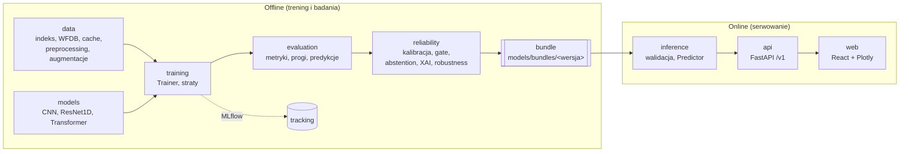
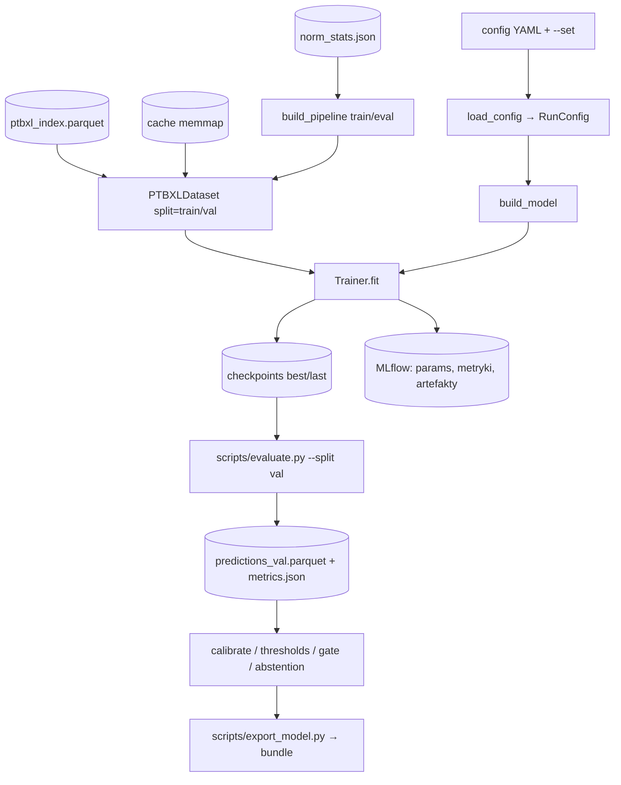

# Architektura systemu CardioAI

## 1. Cel dokumentu

Opisuje podział systemu na warstwy i pakiety, dozwolone zależności, przepływ danych w treningu i inferencji
oraz semantykę statusów. Zasada nadrzędna: **separacja danych, modelu, warstwy niezawodności i produktu** —
każdą warstwę można testować osobno i wymieniać bez przepisywania pozostałych.

## 2. Warstwy systemu

Jedynym łącznikiem między światem offline a online jest **bundle** (`docs/inference_api.md` §2).
API nie importuje kodu treningowego ani MLflow.

## 3. Pakiety i odpowiedzialności

| Pakiet | Odpowiedzialność | Kluczowe moduły | Właściciel |
|---|---|---|---|
| `cardioai.constants` | stałe domenowe | `constants.py` | tworzy T001 (C), właściciel merytoryczny A |
| `cardioai.config` | schemat i ładowanie configu | `schema.py`, `loader.py` | B |
| `cardioai.utils` | device, seed, logging, git, środowisko | `device.py`, `seed.py`, `logging.py`, `git.py`, `env.py` | B/C |
| `cardioai.tracking` | integracja z MLflow, podsumowania runów, wrapper rejestru | `mlflow_utils.py`, `summary.py`, `pyfunc.py` | C |
| `cardioai.data` | wszystko od pliku WFDB do tensora | `download.py`, `checksums.py`, `labels.py`, `index.py`, `contract.py`, `wfdb_io.py`, `transforms.py`, `samplers.py`, `dataset.py`, `datamodule.py`, `test_lock.py`, `cache.py`, `normalization.py`, `filters.py`, `preprocessing.py`, `augmentations.py`, `corruptions.py`, `quality_labels.py`, `quality_eval.py`, `features.py`, `eda.py`, `metadata.py`, `aux_labels.py` | A |
| `cardioai.models` | sieci i ich składanie | `base.py`, `registry.py`, `heads.py`, `utils.py`, `debug.py`, `cnn.py`, `resnet1d.py`, `transformer.py`, `fusion.py` | B |
| `cardioai.training` | pętla uczenia | `trainer.py`, `losses.py`, `class_weights.py`, `optim.py`, `checkpoint.py`, `predict.py` | B |
| `cardioai.evaluation` | metryki i raporty | `metrics.py`, `thresholds.py`, `predictions.py`, `report.py`, `subgroups.py`, `bootstrap.py`, `classical.py`, `plots.py` | B (metryki: C) |
| `cardioai.reliability` | niezawodność predykcji | `calibration.py`, `quality_gate.py`, `abstention.py`, `xai.py`, `robustness.py`, `report.py` | C (gate: A) |
| `cardioai.inference` | serwowanie modelu poza treningiem | `types.py`, `mock.py`, `bundle.py`, `input_io.py`, `validation.py`, `predictor.py`, `onnx_backend.py` | C |
| `cardioai_api` | HTTP, schematy JSON, tryb demo | `main.py`, `settings.py`, `schemas.py`, `errors.py`, `routes/` | C |
| `web/` | interfejs użytkownika | `src/pages/`, `src/components/`, `src/api/` | C |

Rozszerzenie względem specyfikacji: wydzielone pakiety `evaluation`, `tracking` oraz pakiet `api/cardioai_api` (`docs/decisions.md` D-008).

## 4. Granice modułów

Tabela dozwolonych importów jest w `AGENTS.md` §3 i jest egzekwowana przez `import-linter`
(kontrakty w `pyproject.toml`, zadanie T001). Najważniejsze konsekwencje:

- `data` i `models` są od siebie niezależne — Dataset nie zna modelu, model nie zna PTB-XL.
- `evaluation` operuje na tablicach NumPy (y_true, y_prob), nie na modelach.
- `inference` składa pipeline z `data.preprocessing`, `models` i `reliability`, ale nigdy z `training`.
- `cardioai_api` widzi tylko `cardioai.inference` — dzięki temu wymiana modelu nie dotyka API.

Zakazy importów dotyczą importów bezpośrednich; importy pośrednie (przez `cardioai.inference`) są dozwolone (`docs/decisions.md` D-024).

## 5. Przepływ treningu

1. `load_config` łączy `extends` i nadpisania `--set`, waliduje schemat i liczy `config_hash` (`docs/config.md` §6).
2. `PTBXLDataset` czyta indeks, sygnał (cache lub WFDB) i przepuszcza go przez pipeline (`docs/data_contract.md` §8).
3. `Trainer` liczy stratę wielozadaniową, waliduje co epokę na val, zapisuje checkpointy i loguje do MLflow.
4. `evaluate.py` generuje plik predykcji val — wejście dla kalibracji, progów, quality gate i abstention.
5. `export_model.py` zamyka model i wszystkie dopasowane komponenty w bundle z wersją.

## 6. Przepływ inferencji

Zgodny z sekcją 3.1 specyfikacji; każdy krok ma jedną funkcję w `cardioai.inference`.

| Krok | Działanie | Implementacja | Wynik przy niepowodzeniu |
|---|---|---|---|
| 1 | Parsowanie pliku (WFDB, NPZ, CSV) | `input_io.parse_upload` | błąd HTTP 400/422 |
| 2 | Walidacja: 12 odprowadzeń, fs, długość, NaN/Inf, jednostki, amplitudy | `validation.validate_ecg` | błąd HTTP 422 lub ostrzeżenie |
| 3 | Preprocessing zgodny z bundlem | `data.preprocessing.build_pipeline(train=False)` | — |
| 4a | Reguły twarde jakości (na sygnale w mV po walidacji) | `reliability.quality_gate.QualityGate` | `WARN` lub status `REJECTED` (≥ 3 płaskie odprowadzenia) |
| 5 | Forward modelu (diagnoza + jakość), opcjonalnie z metadanymi | `models` (wagi z bundla) | — |
| 4b | Decyzja gate: reguły twarde + głowa jakości → `ACCEPT` / `WARN` / `REJECT` | `reliability.quality_gate.QualityGate.decide` | status `REJECTED` |
| 6 | Kalibracja i progi per klasa | `reliability.calibration`, `evaluation.thresholds` | — |
| 7 | Niepewność i abstention | `reliability.abstention.AbstentionPolicy` | status `ABSTAIN` |
| 8 | Atrybucja XAI (dla statusu `OK` albo na żądanie) | `reliability.xai.explain` | `explanation: null` |
| 9 | Złożenie `PredictionResult` → JSON | `inference.predictor.Predictor.predict` → `cardioai_api` | — |

Kolejność wykonania: 1, 2, 3, 4a, 5, 4b, 6–9 — decyzja gate (4b) wymaga logitów głowy jakości z forwardu (5).

## 7. Statusy i semantyka odpowiedzi

| Sytuacja | HTTP | `status` | `signal_quality.status` | `predictions` | `explanation` |
|---|---|---|---|---|---|
| Plik nieczytelny lub niezgodny z kontraktem | 400/413/422 | — (koperta błędu) | — | — | — |
| Jakość nieakceptowalna | 200 | `REJECTED` | `REJECT` | `null` | `null` |
| Jakość wątpliwa, model pewny | 200 | `OK` | `WARN` | wartości | tak |
| Model niepewny | 200 | `ABSTAIN` | `ACCEPT` lub `WARN` | wartości (do wglądu) | tylko gdy `explain=always` |
| Wszystko w porządku | 200 | `OK` | `ACCEPT` | wartości | tak |

UI musi prezentować `ABSTAIN` jako „wymaga ręcznej oceny”, a nie jako wynik modelu (`docs/frontend.md` §7).

## 8. Cykl życia artefaktów

| Artefakt | Powstaje w | Przechowywanie | Wersjonowanie |
|---|---|---|---|
| Surowe dane PTB-XL | `download_ptbxl.py` | `data/raw/ptb-xl-1.0.3/` (poza gitem) | `MANIFEST.json` + SHA-256 |
| Indeks etykiet | `build_index.py` | `data/interim/` | hash źródłowych CSV w `.meta.json` |
| Cache sygnałów | `build_cache.py` | `data/processed/` | `meta.json` + hash indeksu |
| Statystyki normalizacji | `compute_norm_stats.py` | `data/interim/` | id preprocessingu + hash indeksu |
| Checkpoint | `train.py` | `outputs/` + artefakt MLflow | `config_hash`, git SHA |
| Predykcje i metryki | `evaluate.py` | artefakt MLflow `eval/<split>/` | run MLflow |
| Bundle | `export_model.py` | `models/bundles/<wersja>/`, wydanie GitHub, rejestr MLflow | semver `model_version` |
| Obrazy Docker | CI (tag `v*`) | GHCR | tag wydania |

## 9. Poziomy funkcjonalne i bramki

| Poziom | Zakres | Bramki |
|---|---|---|
| MVP | loader PTB-XL, 100 Hz, 5 superklas, baseline'y, ResNet1D, metryki, MLflow | G1, G2, G3 |
| Core | QualityNet, kalibracja, abstention, XAI, robustness, API + UI, deployment | G4, G5, G6 |
| Extended | Transformer, fuzja metadanych, 500 Hz, głowy pomocnicze, ONNX | — (po ustabilizowaniu Core) |
| Research+ | etykiety hierarchiczne, self-supervised, walidacja zewnętrzna | poza zakresem przedmiotu |

Warunki bramek G1–G6 są w `tasks/README.md` §5.
