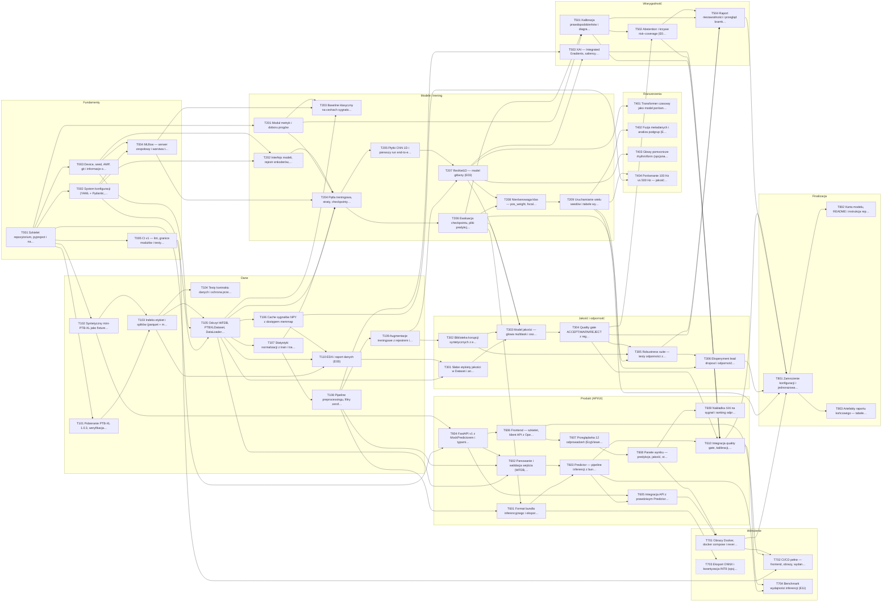

# Backlog CardioAI

> Plik generowany przez `python scripts/tasks.py backlog` z front matter kart `tasks/T###-*.md`. Nie edytuj ręcznie —
> zmień kartę i wygeneruj ponownie. Opis procesu: `tasks/README.md`.

## Podsumowanie

Zadań: **55**, ukończonych: **0** (0%).

| Poziom | Zadania | Osobodni (plan) | Ukończone |
|---|---|---|---|
| MVP | 24 | 29.5 | 0 |
| Core | 26 | 33.0 | 0 |
| Extended | 5 | 7.5 | 0 |

| Osoba | Rola | Zadania | Osobodni (plan) |
|---|---|---|---|
| A | Data & Signal ML | 18 | 22.0 |
| B | Model & Experiments | 18 | 22.5 |
| C | Reliability & Product | 19 | 25.5 |

## Bramki jakościowe

| Bramka | Zadania | Postęp |
|---|---|---|
| G1 | T001, T002, T003, T004, T005, T101, T102, T103, T104, T105, T106, T107, T110 | 0/13 |
| G2 | T201, T202, T203, T204, T205, T206 | 0/6 |
| G3 | T108, T109, T207, T208, T209 | 0/5 |
| G4 | T301, T302, T303, T304, T305, T306, T501, T502, T504 | 0/9 |
| G5 | T503, T601, T602, T603, T604, T605, T606, T607, T608, T609, T610, T701, T702, T704 | 0/14 |
| G6 | T801, T802, T803 | 0/3 |

Warunki przejścia bramek: `tasks/README.md` §5.

## Wszystkie zadania

| ID | Zadanie | Epik | Wł. | Rec. | Tydz. | Rozm. | Poziom | Bramka | Eksp. | Zależy od | Status |
|---|---|---|---|---|---|---|---|---|---|---|---|
| [T001](T001-repo-scaffold.md) | Szkielet repozytorium, pyproject i narzędzia jakości | Fundamenty | C | B | 1 | M | MVP | G1 | — | — | ⬜ todo |
| [T002](T002-config-system.md) | System konfiguracji (YAML + Pydantic, extends, --set, config_hash) | Fundamenty | B | C | 1 | M | MVP | G1 | — | T001 | ⬜ todo |
| [T003](T003-device-seed-env.md) | Device, seed, AMP, git i informacje o środowisku | Fundamenty | B | A | 1 | S | MVP | G1 | — | T001 | ⬜ todo |
| [T004](T004-mlflow-tracking.md) | MLflow — serwer zespołowy i warstwa trackingu | Fundamenty | C | B | 1 | M | MVP | G1 | — | T002, T003 | ⬜ todo |
| [T005](T005-ci-pipeline-v1.md) | CI v1 — lint, granice modułów i testy na każdym PR | Fundamenty | B | C | 1 | S | MVP | G1 | — | T001 | ⬜ todo |
| [T101](T101-download-verify.md) | Pobieranie PTB-XL 1.0.3, weryfikacja SHA-256 i manifest | Dane | A | C | 1 | M | MVP | G1 | — | T001 | ⬜ todo |
| [T102](T102-mini-ptbxl-fixture.md) | Syntetyczny mini-PTB-XL jako fixture testów | Dane | A | B | 1 | M | MVP | G1 | — | T001 | ⬜ todo |
| [T103](T103-label-index.md) | Indeks etykiet i splitów (parquet + meta) | Dane | A | B | 2 | M | MVP | G1 | E00 | T101, T102 | ⬜ todo |
| [T104](T104-data-contract-tests.md) | Testy kontraktu danych i ochrona przed przeciekiem | Dane | A | C | 2 | S | MVP | G1 | E00 | T103 | ⬜ todo |
| [T105](T105-wfdb-dataset-loader.md) | Odczyt WFDB, PTBXLDataset, DataLoadery i blokada testu | Dane | A | B | 2 | M | MVP | G1 | — | T002, T003, T103 | ⬜ todo |
| [T106](T106-signal-cache.md) | Cache sygnałów NPY z dostępem memmap | Dane | A | B | 3 | S | MVP | G1 | — | T105 | ⬜ todo |
| [T107](T107-normalization-stats.md) | Statystyki normalizacji z train i transformacja Normalize | Dane | A | B | 3 | S | MVP | G1 | — | T105 | ⬜ todo |
| [T108](T108-preprocessing-filters.md) | Pipeline preprocessingu, filtry zerofazowe i resampling | Dane | A | B | 4 | M | MVP | G3 | — | T107 | ⬜ todo |
| [T109](T109-augmentations.md) | Augmentacje treningowe z rejestrem i walidacją parametrów | Dane | A | B | 4 | M | MVP | G3 | E06 | T108 | ⬜ todo |
| [T110](T110-eda-report.md) | EDA i raport danych (E00) | Dane | A | B | 3 | M | MVP | G1 | E00 | T103, T105, T106 | ⬜ todo |
| [T201](T201-metrics-thresholds.md) | Moduł metryk i doboru progów | Modele i trening | C | B | 2 | M | MVP | G2 | — | T001 | ⬜ todo |
| [T202](T202-model-interface.md) | Interfejs modeli, rejestr enkoderów, głowy i narzędzia | Modele i trening | B | A | 2 | S | MVP | G2 | — | T002, T003 | ⬜ todo |
| [T203](T203-classical-baseline.md) | Baseline klasyczny na cechach sygnałowych (E01) | Modele i trening | C | B | 3 | M | MVP | G2 | E01 | T004, T105, T201 | ⬜ todo |
| [T204](T204-trainer.md) | Pętla treningowa, straty, checkpointy i scripts/train.py | Modele i trening | B | C | 3 | L | MVP | G2 | — | T004, T105, T107, T201, T202 | ⬜ todo |
| [T205](T205-cnn-baseline.md) | Płytki CNN 1D i pierwszy run end-to-end (E02) | Modele i trening | B | A | 3 | S | MVP | G2 | E02 | T204 | ⬜ todo |
| [T206](T206-evaluate-predictions.md) | Ewaluacja checkpointu, pliki predykcji i metryk | Modele i trening | B | C | 4 | M | MVP | G2 | — | T204 | ⬜ todo |
| [T207](T207-resnet1d.md) | ResNet1D — model główny (E03) | Modele i trening | B | A | 4 | M | MVP | G3 | E03 | T109, T205 | ⬜ todo |
| [T208](T208-imbalance-thresholds.md) | Nierównowaga klas — pos_weight, focal loss, progi (E04) | Modele i trening | B | C | 5 | M | MVP | G3 | E04 | T206, T207 | ⬜ todo |
| [T209](T209-multiseed-summary.md) | Uruchamianie wielu seedów i tabele wyników z MLflow (bramka G3) | Modele i trening | B | A | 5 | S | MVP | G3 | E03 | T208 | ⬜ todo |
| [T301](T301-weak-quality-labels.md) | Słabe etykiety jakości w Dataset i analiza ich wiarygodności | Jakość i odporność | A | B | 5 | S | Core | G4 | E05 | T105, T110 | ⬜ todo |
| [T302](T302-synthetic-corruptions.md) | Biblioteka korupcji syntetycznych z etykietami jakości | Jakość i odporność | A | B | 5 | M | Core | G4 | E05 | T109 | ⬜ todo |
| [T303](T303-quality-head.md) | Model jakości — głowa multitask i osobny QualityNet (E05) | Jakość i odporność | A | B | 6 | M | Core | G4 | E05 | T206, T207, T301, T302 | ⬜ todo |
| [T304](T304-quality-gate.md) | Quality gate ACCEPT/WARN/REJECT z regułami twardymi i progami z val | Jakość i odporność | A | C | 6 | M | Core | G4 | E05 | T303 | ⬜ todo |
| [T305](T305-robustness-suite.md) | Robustness suite — testy odporności z raportem | Jakość i odporność | B | A | 7 | M | Core | G4 | E06 | T206, T302, T304 | ⬜ todo |
| [T306](T306-lead-dropout-experiment.md) | Eksperyment lead dropout i odporność kanałowa (E06, H3) | Jakość i odporność | B | A | 7 | S | Core | G4 | E06 | T209, T305 | ⬜ todo |
| [T401](T401-transformer.md) | Transformer czasowy jako model porównawczy (E07) | Rozszerzenia | B | C | 8 | M | Extended | — | E07 | T207 | ⬜ todo |
| [T402](T402-metadata-fusion.md) | Fuzja metadanych i analiza podgrup (E08, H2) | Rozszerzenia | B | A | 9 | M | Extended | — | E08 | T209 | ⬜ todo |
| [T403](T403-aux-heads.md) | Głowy pomocnicze rhythm/form (opcjonalne, E05) | Rozszerzenia | A | B | 9 | M | Extended | — | E05 | T207 | ⬜ todo |
| [T404](T404-sampling-rate-500hz.md) | Porównanie 100 Hz vs 500 Hz — jakość a koszt (E10, H5) | Rozszerzenia | B | C | 11 | M | Extended | — | E10 | T106, T209 | ⬜ todo |
| [T501](T501-calibration.md) | Kalibracja prawdopodobieństw i diagramy niezawodności (E09) | Wiarygodność | C | B | 10 | M | Core | G4 | E09 | T201, T206 | ⬜ todo |
| [T502](T502-abstention.md) | Abstention i krzywe risk–coverage (E09, H4) | Wiarygodność | C | B | 10 | M | Core | G4 | E09 | T304, T501 | ⬜ todo |
| [T503](T503-xai.md) | XAI — Integrated Gradients, saliency i agregacje (E11) | Wiarygodność | C | A | 8 | M | Core | G5 | E11 | T108, T207 | ⬜ todo |
| [T504](T504-reliability-report.md) | Raport niezawodności i przegląd bramki G4 | Wiarygodność | C | B | 11 | S | Core | G4 | E09 | T304, T305, T501, T502 | ⬜ todo |
| [T601](T601-inference-bundle.md) | Format bundla inferencyjnego i eksport z checkpointu | Produkt (API/UI) | B | C | 6 | M | Core | G5 | — | T108, T206 | ⬜ todo |
| [T602](T602-input-parsing-validation.md) | Parsowanie i walidacja wejścia (WFDB, NPZ, CSV) | Produkt (API/UI) | A | C | 8 | M | Core | G5 | — | T105, T108, T604 | ⬜ todo |
| [T603](T603-predictor.md) | Predictor — pipeline inferencji z bundla | Produkt (API/UI) | C | B | 9 | M | Core | G5 | — | T601, T602 | ⬜ todo |
| [T604](T604-api-mock.md) | FastAPI v1 z MockPredictorem i typami inferencji (kontrakt-first) | Produkt (API/UI) | C | A | 3 | M | Core | G5 | — | T001, T102 | ⬜ todo |
| [T605](T605-api-real-predictor.md) | Integracja API z prawdziwym Predictorem i rekordami demo | Produkt (API/UI) | C | B | 12 | M | Core | G5 | — | T603, T604 | ⬜ todo |
| [T606](T606-frontend-scaffold.md) | Frontend — szkielet, klient API z OpenAPI, strony i tryb demo | Produkt (API/UI) | C | A | 4 | M | Core | G5 | — | T604 | ⬜ todo |
| [T607](T607-ecg-viewer.md) | Przeglądarka 12 odprowadzeń (EcgViewer) | Produkt (API/UI) | C | A | 5 | M | Core | G5 | — | T606 | ⬜ todo |
| [T608](T608-result-panels.md) | Panele wyniku — predykcje, jakość, status, informacje o modelu | Produkt (API/UI) | C | B | 6 | M | Core | G5 | — | T607 | ⬜ todo |
| [T609](T609-xai-overlay.md) | Nakładka XAI na sygnał i ranking odprowadzeń | Produkt (API/UI) | C | A | 11 | S | Core | G5 | E11 | T608 | ⬜ todo |
| [T610](T610-predictor-reliability-integration.md) | Integracja quality gate, kalibracji, abstention i XAI w Predictorze | Produkt (API/UI) | C | A | 12 | M | Core | G5 | — | T304, T501, T502, T503, T603 | ⬜ todo |
| [T701](T701-docker-compose.md) | Obrazy Docker, docker compose i reverse proxy | Wdrożenie | C | B | 13 | M | Core | G5 | — | T605, T608 | ⬜ todo |
| [T702](T702-cicd-release.md) | CI/CD pełne — frontend, obrazy, wydania i promocja modelu | Wdrożenie | C | A | 13 | M | Core | G5 | — | T005, T606, T701 | ⬜ todo |
| [T703](T703-onnx-quantization.md) | Eksport ONNX i kwantyzacja INT8 (opcjonalne, E11) | Wdrożenie | B | C | 13 | M | Extended | — | E11 | T601 | ⬜ todo |
| [T704](T704-runtime-benchmark.md) | Benchmark wydajności inferencji (E11) | Wdrożenie | A | B | 13 | S | Core | G5 | E11 | T603, T610 | ⬜ todo |
| [T801](T801-freeze-final-test.md) | Zamrożenie konfiguracji i jednorazowa ewaluacja na foldzie 10 (G6) | Finalizacja | B | C | 14 | M | Core | G6 | — | T209, T306, T504, T610, T701 | ⬜ todo |
| [T802](T802-model-card-readme.md) | Karta modelu, README i instrukcja reprodukcji | Finalizacja | C | A | 14 | S | Core | G6 | — | T801 | ⬜ todo |
| [T803](T803-final-report-assets.md) | Artefakty raportu końcowego — tabele i wykresy | Finalizacja | A | C | 14 | M | Core | G6 | — | T801 | ⬜ todo |

## Plan tygodniowy

Rozmiary: S ≈ 0,5 dnia, M ≈ 1–2 dni, L ≈ 3+ dni pracy z agentem. Zadania Extended zaznaczono kursywą.

| Tydzień | A — Data & Signal ML | B — Model & Experiments | C — Reliability & Product |
|---|---|---|---|
| 1 | T101 (M), T102 (M) | T002 (M), T003 (S), T005 (S) | T001 (M), T004 (M) |
| 2 | T103 (M), T104 (S), T105 (M) | T202 (S) | T201 (M) |
| 3 | T106 (S), T107 (S), T110 (M) | T204 (L), T205 (S) | T203 (M), T604 (M) |
| 4 | T108 (M), T109 (M) | T206 (M), T207 (M) | T606 (M) |
| 5 | T301 (S), T302 (M) | T208 (M), T209 (S) | T607 (M) |
| 6 | T303 (M), T304 (M) | T601 (M) | T608 (M) |
| 7 | — | T305 (M), T306 (S) | — |
| 8 | T602 (M) | *T401 (M)* | T503 (M) |
| 9 | *T403 (M)* | *T402 (M)* | T603 (M) |
| 10 | — | — | T501 (M), T502 (M) |
| 11 | — | *T404 (M)* | T504 (S), T609 (S) |
| 12 | — | — | T605 (M), T610 (M) |
| 13 | T704 (S) | *T703 (M)* | T701 (M), T702 (M) |
| 14 | T803 (M) | T801 (M) | T802 (S) |

## Ścieżka krytyczna (MVP + Core)

Najdłuższy łańcuch zależności: **20.5 osobodnia** pracy sekwencyjnej.

T001 Szkielet repozytorium, pyproj… → T101 Pobieranie PTB-XL 1.0.3, wery… → T103 Indeks etykiet i splitów (par… → T105 Odczyt WFDB, PTBXLDataset, Da… → T107 Statystyki normalizacji z tra… → T204 Pętla treningowa, straty, che… → T205 Płytki CNN 1D i pierwszy run… → T207 ResNet1D — model główny (E03) → T303 Model jakości — głowa multita… → T304 Quality gate ACCEPT/WARN/REJE… → T502 Abstention i krzywe risk–cove… → T610 Integracja quality gate, kali… → T801 Zamrożenie konfiguracji i jed… → T803 Artefakty raportu końcowego —…

Opóźnienie dowolnego zadania z tej listy przesuwa zamrożenie modelu (T801).

## Graf zależności

